# PitSignal



[Português](README.pt-BR.md) · English

Open source under the [MIT License](LICENSE). For repository upload instructions, see [Publish on GitHub](PUBLICAR_GITHUB.md). Third-party copyright and license notices are preserved.

Developed by **Kintounn**.

A racing telemetry dashboard with Windows race radio. **Tested with F1 24 (F1 2024).** Compatibility with other editions has not been verified; the current implementation uses the 2024 telemetry format. Integrations with other games and a coaching system are planned; they are not implemented yet. Open the dashboard on your PC or scan the local QR code to use a phone/tablet on the same network.

## Start on Windows

1. Install Python 3.9 or newer.
2. Extract all files together. Double-click **START.bat** (or **INICIAR.bat**).
3. Select **English** or **Português** in **Idioma / Language** at the top of the dashboard.
4. Scan the QR code on the PC with your phone/tablet camera. Keep the program running.
5. Set F1 24 telemetry: UDP **On**, broadcast **Off**, IP **127.0.0.1**, port **20777**, format **2024**, rate **20 Hz**. Enter the track.

Run **DEMO.bat** to explore simulated telemetry without the game. Stop it before starting live mode. No pip packages or paid API are required.

Alternatively:

```powershell
py -3 painel_web.py
py -3 painel_web.py --demo
```

## Language and voice

The selector translates the dashboard, dialogs, alerts, settings and radio messages. Language is saved per PC/user and shared with connected browsers; changing it also changes narration. Existing alert settings and the saved access code are preserved.

Speech plays through the PC's default Windows audio output. Select your headphones before starting and press **Test radio on PC**. Install a compatible English or Portuguese Windows speech voice for the selected language if requested. No voice audio is generated or sent to a cloud service.

The startup launcher uses bilingual guidance because dashboard language is selected after it starts.

## Features

- Live gear, speed, fuel, ERS, DRS, tyre wear and configurable temperature dots.
- Shift-light bar, centered throttle/brake bar and coloured flag panel.
- Race-best detection using valid lap histories from the field.
- Visual and spoken summaries, gaps ahead/behind, adjustable lap intervals.
- Per-component alert switches and percentage steps, saved locally.
- Local QR code generated for each PC's address and access code.

## Practical limits

Windows is needed for local speech. Phone and PC must share a local network; allow Python on private networks if Windows asks. QR codes update after restarting when the PC's IP changes. Keep the app running and use the current local link.

This is a rule-based prototype. Pit windows and fuel margin come from the game. Temperature bands are adjustable references. Full-field best-lap confirmation requires the relevant history packets; unavailable data is not invented. Browser wake-lock may be unavailable on local HTTP; configure the tablet's screen timeout when needed.

Preferences and the access code live in `%LOCALAPPDATA%\PitSignal`. They are created on each PC and are not included in this repository. Existing preferences and access codes from the previous Coach F1 app are imported automatically on first use, without overwriting PitSignal preferences.

## Localisation source

`translations.tsv` holds Portuguese-to-English display and speech phrases. `i18n.py` applies the catalogue locally; no automatic translation service is used. Portuguese is the canonical internal message language. UI source is `painel.html`. Windows voice selection is in `voz.ps1`.

The included `qrcodegen.py` is by Project Nayuki under the MIT license; its complete copyright and license notice remains in that file. No Turing USB driver or USB display component is included.
