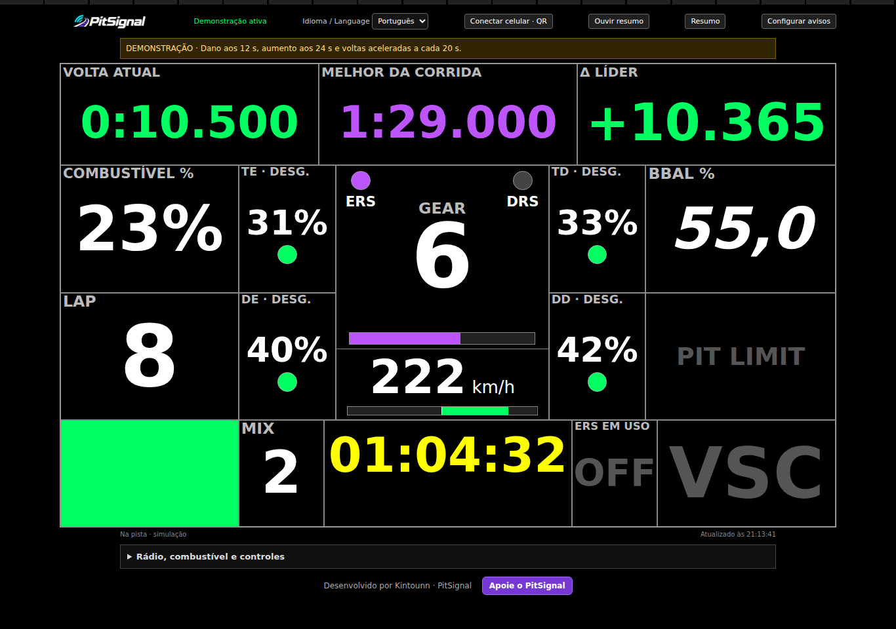
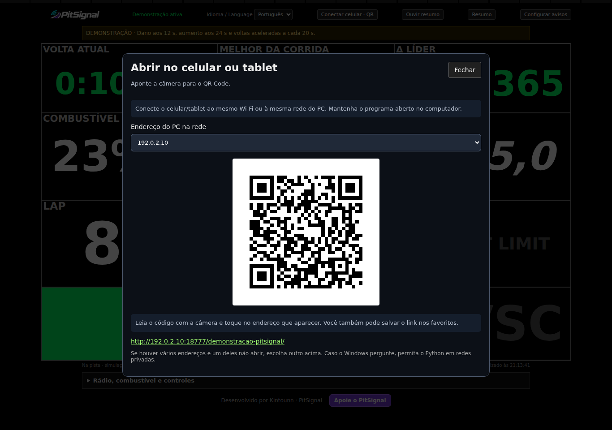
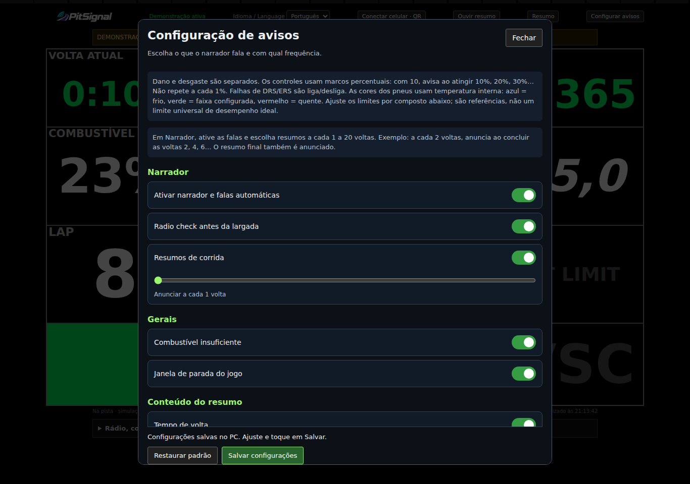

# PitSignal

Português · [English](README.md)

Código aberto sob a [licença MIT](LICENSE). Para enviar o projeto, leia [Publicar no GitHub](PUBLICAR_GITHUB.md). Os avisos de autoria e licença dos componentes de terceiros foram preservados.

Desenvolvido por **Kintounn**.

Dashboard de telemetria de corrida com rádio pelo Windows e acesso pelo navegador do PC, celular ou tablet. **Testado com F1 24 (F1 2024).** A compatibilidade com outras edições ainda não foi verificada; a implementação atual usa o formato de telemetria 2024. O coach e integrações com outros jogos estão planejados e ainda não foram implementados.

## Apoie o projeto

Gostou do PitSignal? Você pode apoiar o desenvolvimento pelo Ko-fi. A contribuição é voluntária; o programa continua gratuito e de código aberto.

## Screenshots

Capturas reais do programa em **modo demonstração**, com dados fictícios.

### Dashboard

### Conectar celular ou tablet por QR Code

O endereço e o QR Code acima são exemplos para documentação. No seu PC, o programa gera o código de conexão da sua própria rede.

### Configuração de avisos

## Como usar

1. Instale Python 3.9 ou superior e extraia todos os arquivos juntos.
2. Abra **INICIAR.bat**.
3. No topo do painel, escolha **Português** ou **English** em **Idioma / Language**.
4. Leia o QR Code do PC com o celular/tablet, na mesma rede. Mantenha o programa aberto.
5. No F1 24: UDP ativado, broadcast desativado, IP `127.0.0.1`, porta `20777`, formato `2024`, frequência `20 Hz`. Entre na pista.

**DEMONSTRACAO.bat** abre o modo de teste com dados fictícios. Feche antes do modo real. Não é necessário instalar bibliotecas extras ou contratar API.

## Idioma e narrador

A seleção traduz painel, janelas, configurações, avisos e falas. Fica salva por PC/usuário e é compartilhada com os navegadores conectados. A mudança também altera o idioma do narrador. As preferências de avisos e o código de acesso anteriores são preservados.

O áudio sai pelo dispositivo padrão do Windows. Conecte seu fone antes de iniciar e use **Testar rádio no PC**. É necessário ter uma voz compatível do idioma escolhido instalada no Windows; o painel informa se faltar. Não usa serviço de tradução ou de voz na nuvem.

O atalho inicial exibe orientações bilíngues, pois a seleção do painel ocorre depois da inicialização.

## Recursos e limites

Inclui marcha, velocidade, combustível, ERS, DRS, pneus, bandeiras, melhor volta geral, resumos, intervalos entre carros e configurações por componente. O QR Code é gerado com o endereço e código de acesso de cada PC.

É um protótipo por regras. Estratégia de boxes e margem de combustível vêm do jogo. Faixas de temperatura são referências ajustáveis. A melhor volta depende dos históricos válidos dos pilotos. Dados indisponíveis não são inventados.

A voz requer Windows. PC e do dispositivo movel devem estar na mesma rede; permita Python em redes privadas se solicitado. Se o IP do PC mudar, reinicie para atualizar o QR Code. O navegador pode impedir manter a tela ligada no HTTP local; ajuste o tempo de bloqueio do tablet quando necessário.

As configurações são criadas em `%LOCALAPPDATA%\PitSignal`, fora do pacote.

## Traduções

`translations.tsv` reúne as frases Português/Inglês. `i18n.py` aplica o catálogo localmente. As mensagens internas são escritas em português; `painel.html` contém a interface e `voz.ps1` seleciona a voz do Windows.

`qrcodegen.py`, de Project Nayuki, é distribuído sob MIT, com o aviso completo mantido no arquivo.
